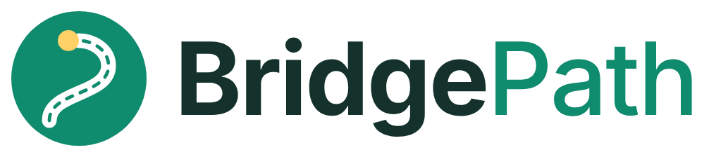
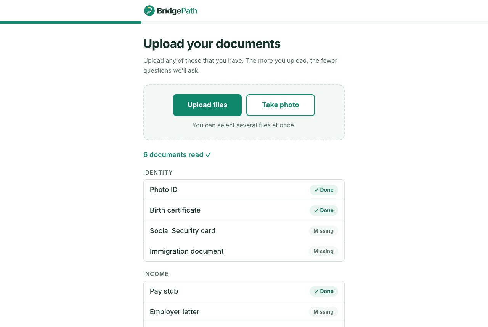
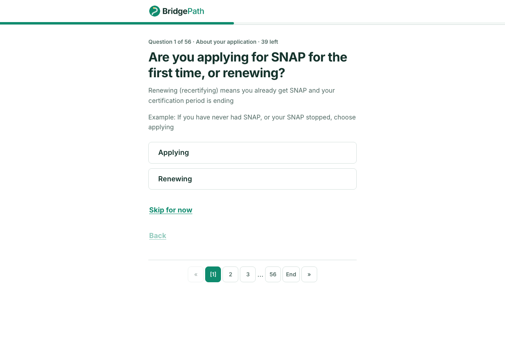
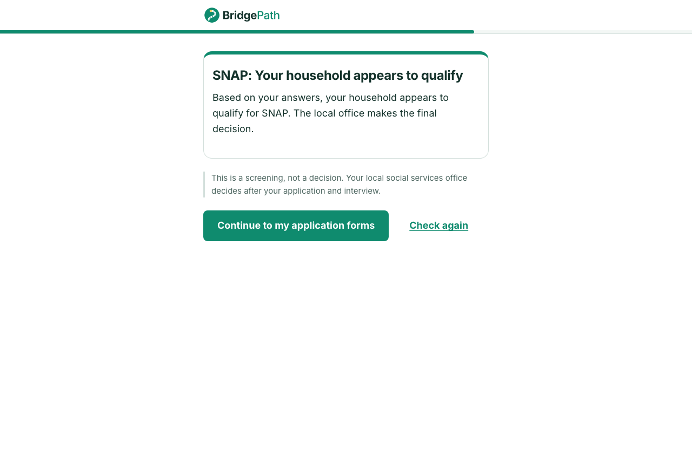
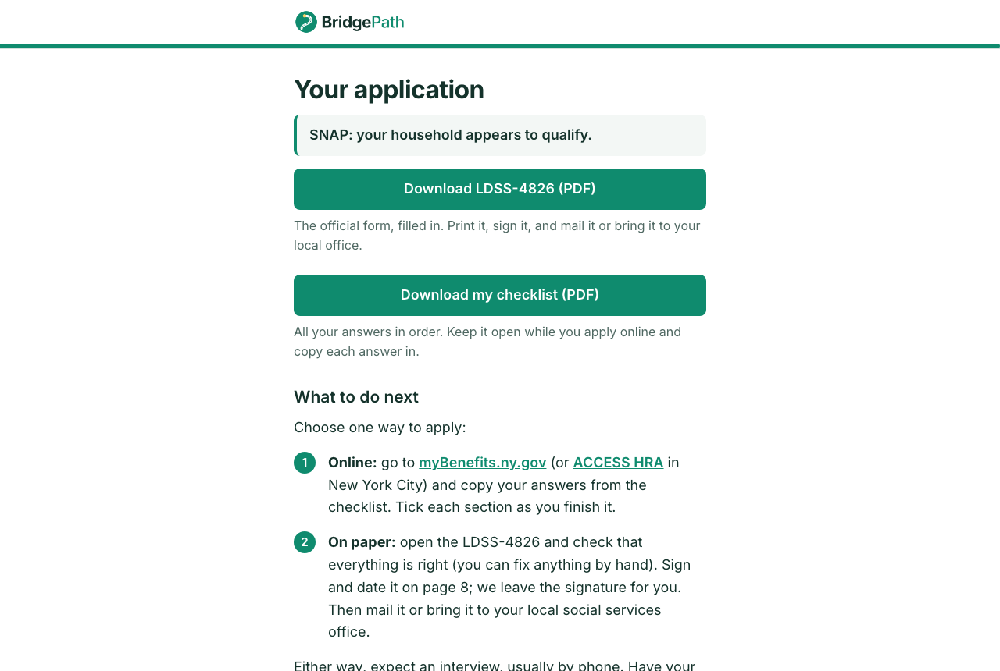

<p align="center">
  
</p>

<p align="center">
  <b>Apply for SNAP food benefits in New York from the documents you already have.</b><br>
  Upload a pay stub, an ID, a lease. BridgePath reads them, asks only what's left, checks whether you're likely to
  qualify, and hands you a filled-in official application.
</p>

---

## The problem

Applying for SNAP (food stamps) in New York means filling out the **LDSS-4826**: about 8 pages and roughly 80
questions about every person in the household, every job, every bill and every bank account. Most of those answers
are already printed on documents people have in a drawer. Filling it out by hand takes hours, mistakes cause
delays, and many eligible families give up or never start.

## What BridgePath does

1. **Upload your documents.** Pay stubs, IDs, birth certificates, leases, utility bills, bank statements, benefit
   letters: 25 document types. Gemini reads each one and pulls out names, dates, income, rent and more.
2. **Answer only what's missing.** BridgePath works through every LDSS-4826 question and skips the ones your
   documents already answered. With all your documents, one person sees about 23 short pages instead of the full
   form.
3. **See if you're likely to qualify.** A SNAP eligibility screening using New York's income limits. If something
   is missing, each item gets an **Answer** or **Upload** button that takes you straight to the fix.
4. **Get your application.** Download the **official LDSS-4826, filled in** and ready to sign, plus a **checklist
   PDF** with every answer in order, so you can copy them into the online application (myBenefits.ny.gov or ACCESS
   HRA).

BridgePath never submits anything for you. You stay in control of your application.

## Screenshots

| Upload documents | One question at a time |
| --- | --- |
|  |  |
| **Eligibility result** | **Your filled application** |
|  |  |

## Privacy by design

People applying for benefits share their most sensitive information, so BridgePath keeps as little as possible:

- **Nothing is stored.** No database, no accounts. Uploaded files are processed in memory and never written to
  disk. Your answers live only in your browser tab and are gone when you close it or press **Delete my information**.
- **No personal data in logs.** The backend logs only anonymous events (document type, eligibility status), never
  names, numbers, amounts or file contents. Errors returned to the browser are generic and never echo your data.
- **Only what's needed.** The eligibility check is sent without SSNs, phone numbers or addresses.
- **Clear consent first**, explaining what is collected, why, and that documents are read by Google's Gemini AI.

## How it works

```
Home → Consent → Upload → Roster → Questions → Results ──→ Forms
                    │                    │         │  ▲       (filled LDSS-4826 + checklist PDF)
                    ▼                    │         │  └── fix: Answer a question / Upload a document, then re-check
              /api/extract               │         ▼
               (Gemini)                  │   /api/eligibility
                    │                    │   (SNAP rules)
                    └──── applicant ◄────┘
```

Every fact about the household lives in one `applicant` object in the browser. Each answer remembers where it came
from (`{ value, source }`, with `source` = `"document"` or `"user"`), so a document never overwrites something you
typed, and the eligibility check can ask for proof of income you typed in instead of uploading.

| Piece | What it does |
| --- | --- |
| **Document reading** ([gemini.py](backend/app/services/gemini.py)) | One Gemini call per document (`gemini-3.5-flash-lite`, structured output against a [Pydantic schema](backend/app/services/pydantic_schemas.py), temperature 0). It also flags problems like a blurry date. |
| **Question engine** ([QuestionBank.json](frontend/src/data/QuestionBank.json), [questionQueue.js](frontend/src/utils/questionQueue.js)) | Every LDSS-4826 question, with rules for who it applies to (by age, by earlier answers). Only questions the documents didn't answer are asked. |
| **Eligibility screening** ([eligibility_rules.py](backend/app/services/eligibility_rules.py)) | Residency, who counts in the SNAP household (immigration status, students, shared meals), then the gross income test using [FY2027 standards](backend/app/services/snap_standards.py). Returns what's missing instead of guessing. |
| **Form filling** ([pdf_filler.py](backend/app/services/pdf_filler.py), [checklist.py](backend/app/services/checklist.py)) | Fills the official fillable LDSS-4826 field by field, and builds the copy-and-paste checklist. Both are made in memory and returned as downloads. |

## Tech stack

- **Frontend:** React + Vite, plain CSS
- **Backend:** Python, FastAPI
- **AI:** Google Gemini (document reading)
- **PDFs:** pypdf (filling the official form), reportlab (checklist)
- **Tests:** pytest, Vitest, Playwright

## Run it locally

You need Python 3, Node.js, and a free Gemini API key from https://aistudio.google.com/apikey (only needed for
reading documents; everything else works without it).

> Paste the commands below one line at a time, as they are. On macOS (zsh), a pasted `# comment` is treated as extra
> arguments.

**Backend**, in one terminal:

```bash
cd backend
python -m venv venv
source venv/bin/activate
pip install -r requirements.txt
echo "GEMINI_API_KEY=your-key-here" > .env
uvicorn app.main:app --reload
```

The API runs at http://localhost:8000. After pulling new changes, run `pip install -r requirements.txt` again, since
new packages get added.

**Frontend**, in a second terminal:

```bash
cd frontend
npm install
npm run dev
```

Open http://localhost:5173.

### Try it with sample documents

[DemoKit/](DemoKit/) has fictional IDs, pay stubs and utility bills made for demos. Click **I'm ready to apply**,
agree to the consent, upload a few of them, and go through the questions. To see the "needs something" path, skip a
question or type an income instead of uploading a pay stub: the results screen will show buttons to fix it.

## Tests

| Suite | Tool | Covers |
| --- | --- | --- |
| Backend (92 tests) | pytest | Eligibility rules and route, LDSS-4826 filling, the checklist PDF |
| Frontend unit (133 tests) | Vitest | The question engine, merging uploads, automatic answers, the fix buttons, what's sent to the backend |
| Browser (12 scenarios) | Playwright | The whole app clicked through in Chrome, with a screenshot of every step: eligible, not eligible, each "needs something" fix, uploading several files, downloading the form, and a complete applicant who uploads six documents and answers every question |

```bash
cd backend
python -m pytest tests
```

```bash
cd frontend
npm test
```

```bash
cd frontend
npx playwright install chromium
npm run test:e2e
npm run test:e2e:report
```

Run `npx playwright install chromium` once after `npm install`. The browser tests start both servers themselves,
use the real eligibility backend, and answer document uploads with fixtures, so they don't use Gemini quota.
`npm run test:e2e:report` opens a report with screenshots and a step-by-step replay of each test.

## Project structure

```
backend/
  app/routes/       extract.py, eligibility.py, forms.py (the API)
  app/services/     gemini.py, eligibility_rules.py, pdf_filler.py, checklist.py, ...
  app/templates/    official LDSS-4826 / LDSS-2921 forms and instructions
  tests/
frontend/
  src/screens/      one folder per screen (.jsx + .css)
  src/data/         QuestionBank.json, document types
  src/utils/        question engine, merging uploads, api.js (the only door to the backend)
  tests/unit/  tests/e2e/
DemoKit/            fictional sample documents for demos
```

[CLAUDE.md](CLAUDE.md) has detailed architecture notes for developers.

## Limitations

- **A screening, not a decision.** Results are estimates; the local social services office decides. BridgePath
  doesn't estimate benefit amounts.
- **SNAP only for now.** The LDSS-2921 Common Application (cash assistance, Medicaid, child care) is the next
  form; the extraction schema already covers it.
- **Some eligible immigrants are screened out.** Refugees, asylees and other qualified non-citizens can get SNAP,
  but the screening doesn't recognize those statuses yet.
- **People aren't merged across documents.** If two documents name the same person, the roster shows them twice and
  the applicant removes one.
- **Desktop web layout.** Not yet optimized for phones.
- BridgePath is not affiliated with New York State or any government agency.

## After the MVP

Three larger features, planned for after the hackathon.

### 1. Choose which applications to fill

Let applicants pick the programs they want (SNAP, cash assistance, Medicaid, child care) and fill the right form for
each. The backend is already built for this: `POST /api/forms` takes a list of benefits, and the extraction schema
covers both forms.

1. **Choice screen:** add a step where the applicant ticks the programs they want, saved in `applicant`.
2. **Questions per program:** tag each question in QuestionBank.json with the programs that need it, and ask only
   the questions for the chosen programs.
3. **Eligibility per program:** add a rules module for each new program next to the SNAP rules, returning one result
   per program.
4. **LDSS-2921 form:** rename the blank form's fields (they still have Acrobat's default names) using the same
   naming scheme as the LDSS-4826, then add it to the form filler and the checklist.
5. **Tests:** add a complete-applicant scenario for each program.

### 2. Accounts: sign in and come back to an application

Let people save their progress, sign in later and pick up where they left off. This means storing very sensitive
data, so encryption comes first.

1. **Database and sign-in:** a database for accounts and saved applications, with sign-in by email link or a
   one-time code (no passwords to forget).
2. **Encryption layer:** encrypt each saved application before it's written, with a separate key per user held in a
   key management service, so the database alone never reveals anything. Use HTTPS everywhere.
3. **Save and resume:** save the `applicant` object as the user goes, and load it again after sign-in, so they
   return to the same question.
4. **Uploaded files:** keep only the information read from documents, not the files themselves, unless the user
   chooses to keep them.
5. **Control and deletion:** a "Delete my account" that removes everything, automatic deletion of inactive
   applications, and updated consent text explaining what is now stored and for how long.
6. **Keep "no account" mode:** people who don't want an account can still use the app as it works today.

### 3. The app in other languages

Many SNAP applicants in New York are more comfortable in Spanish, Chinese, Russian, Haitian Creole, Bengali, Korean
or another language.

1. **Translatable text:** move every screen's text into translation files with a library like react-i18next, and
   add a language picker on the home page.
2. **Translate the questions:** add translations of each question, explanation and option in QuestionBank.json.
   Answers stay stored the same way, so eligibility and form filling don't change.
3. **Documents in any language:** test Gemini on documents in other languages and translate its issue messages.
4. **Forms and letters:** fill the official form in the applicant's language where the state publishes one,
   translate the checklist PDF, and use the existing "letters in Spanish" option on the form.
5. **Review:** have native speakers check the translations, since a wrong word in a benefits question can lead to
   a wrong answer.
